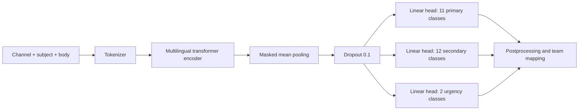
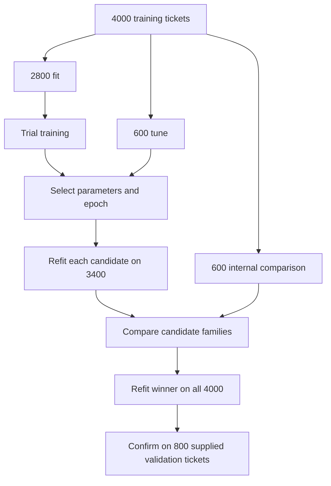
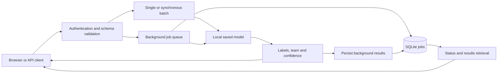

# Team Hydra — TensorForge 2.0

## 1. Project Title

**Team Hydra multilingual ticket classifier, TensorForge 2.0 MVP.** A fine-tuned XLM-R encoder predicts the primary issue, optional secondary issue and urgency, with a deterministic support-team mapping.

- Selected candidate: `FacebookAI/xlm-roberta-base` with three supervised heads.
- Experiment protocol: `tensorforge-tournament-v1`.
- Saved neural API version verified: `hydra-xlmr-f0899a3b764b3324`.
- Internal primary accuracy: **99.83% on 600 comparison tickets**.
- Final winner validation: **pending in the reviewed artifacts**.

The recorded comparison selects XLM-R. This is an internal selection result, not an official competition score. The original baseline scored 57.50% on a different, supplied validation set; these values are not a measured improvement on the same test set.

## 2. Overview

Team Hydra routes multilingual support tickets for the fictional RideEat platform. We created it to handle overlapping issues, informal spelling, Sinhala and Tamil Unicode, and Latin-script transliterations. Each prediction includes primary category, optional secondary category, urgency, mapped team and primary confidence.

Three experiments compare contextual encoders with a lower-cost sparse classifier. Training and inference use local code and saved artifacts. The solution does not call an external LLM for ticket classification. The accompanying [FastAPI service](../tensorforge/README.md) hosts the model and browser frontend.

## 3. Features

- Eleven primary categories, twelve secondary outcomes including `none`, and binary urgency.
- English, Sinhala, Tamil, Singlish, Tanglish and mixed-language performance breakdowns.
- Standalone XLM-R, mDeBERTa and TF-IDF + linear SVM experiments.
- Shared splits, dataset fingerprints, saved predictions and reproducible ranking.
- Hyperparameter search, candidate refitting, final-winner training and offline inference.
- Primary confidence reporting, with sigmoid calibration for SVM.
- Companion API for single predictions, synchronous batches up to 100 and background jobs up to 5,000 tickets.
- Integrated frontend with batch upload, job progress, cancellation and result downloads.

## 4. Model Architecture

### Neural architecture



The word-embedding table stays frozen to reduce optimizer and gradient memory. Encoder layers and classification heads remain trainable. This fine-tunes pretrained encoders rather than training a language model from scratch.

| Property                                            |                         XLM-R |                     mDeBERTa |
| --------------------------------------------------- | ----------------------------: | ---------------------------: |
| Backbone                                            | `FacebookAI/xlm-roberta-base` | `microsoft/mdeberta-v3-base` |
| Transformer layers                                  |                            12 |                           12 |
| Hidden width                                        |                           768 |                          768 |
| Attention heads per layer                           |                            12 |                           12 |
| Feed-forward width                                  |                         3,072 |                        3,072 |
| Vocabulary size                                     |                       250,002 |                      251,000 |
| Saved tensor elements, encoder + heads              |                   278,062,873 |                  278,237,977 |
| Frozen word-embedding elements                      |                   192,001,536 |                  192,768,000 |
| Remaining parameter elements under this freeze rule |                    86,061,337 |                   85,469,977 |

Dimensions come from saved encoder configurations. Counts come from safetensors shapes and the script's embedding freeze rule; training prints exact runtime total/trainable counts. The three output heads together contain 19,225 parameters, including biases.

### Training parameters

| Setting                                | Search/default or selected value                                                        |
| -------------------------------------- | --------------------------------------------------------------------------------------- |
| Learning-rate search                   | `1e-5`, `2e-5`, `3e-5`                                                                  |
| Selected neural learning rate / epochs | `3e-5` / 5 for both saved candidates                                                    |
| Token limit                            | 256; long inputs retain approximately 75% beginning and 25% end                         |
| Microbatch / accumulation              | 2 / 8, effective batch size 16                                                          |
| Optimizer                              | AdamW; weight decay 0.01 excluding bias/normalization                                   |
| Schedule                               | 10% warm-up, then linear decay                                                          |
| Gradient clipping                      | Norm 1.0                                                                                |
| Early-stopping patience                | 2 trial epochs                                                                          |
| Precision                              | FP32 trainable parameters, CUDA FP16 autocast and gradient scaling                      |
| Memory control                         | Frozen word embeddings and gradient checkpointing                                       |
| Loss                                   | Primary cross-entropy + 0.5 secondary loss + 0.5 urgency loss                           |
| Class weights                          | Primary unweighted; bounded inverse-square-root-frequency weights for secondary/urgency |
| Random seed                            | 42                                                                                      |

**Linear SVM:** word and character TF-IDF feed three classifiers. The primary search covers 18 combinations of feature mix, regularization (`C` in 0.25, 1, 4), and class weighting. Selected settings use balanced features, primary `C=1` unweighted, secondary `C=4` unweighted, and urgency `C=1` balanced. Primary confidence uses three-fold sigmoid calibration inside fitting data; those folds share the fitting-set vocabulary.

**Output rules:** a secondary label equal to the primary becomes `none`. Spam becomes nonurgent with no secondary. All candidates use the same rules. The team is a fixed mapping from primary category.

## 5. Technologies

| Technology                                    | Purpose                                     |
| --------------------------------------------- | ------------------------------------------- |
| Python                                        | Training, evaluation and API implementation |
| PyTorch 2.10.0                                | Neural training and inference               |
| Transformers 5.0.0                            | Pretrained encoders and tokenizers          |
| Tokenizers 0.22.2, SentencePiece, safetensors | Tokenization and neural artifacts           |
| NumPy 2.4.1, SciPy 1.17.0                     | Numerical arrays and sparse operations      |
| scikit-learn 1.8.0                            | TF-IDF, SVM, calibration and metrics        |
| Joblib 1.5.3, threadpoolctl                   | Classical persistence and thread control    |
| FastAPI, Uvicorn, JSON Schema                 | Companion API and validation                |
| SQLite, Docker                                | Persistent jobs and portable serving        |
| HTML, CSS, JavaScript                         | Browser frontend                            |
| Matplotlib, optional                          | README chart generation                     |

TensorFlow is not used. Install the committed requirement files. Saved neural metadata records Python 3.14.6 and PyTorch 2.10.0+cu128.

## 6. Project Structure

```text
model-tournament/
├── README.md
├── .gitignore
├── computer_1_xlmr.py          # XLM-R + shared compare/finalize/predict commands
├── computer_2_mdeberta.py      # mDeBERTa + shared commands
├── computer_3_linear_svm.py    # SVM search + shared commands
├── requirements-cpu.txt
├── requirements-gpu.txt
├── data/
│   ├── DATA_NOTES.md           # Provenance and labeling policy
│   ├── train.jsonl            # Transfer separately if excluded from Git
│   └── validation.jsonl
├── results_xlmr/              # Model, reports and split manifest
├── results_mdeberta/
├── results_svm/
├── comparison/
│   ├── leaderboard.json
│   └── winner.json
├── best_model/                # Created by finalize; not present yet
├── docs/
│   ├── generate_charts.py      # Reproduce the charts from saved results
│   └── images/                # PNG charts embedded below
└── verification.md            # Earlier development checks
└── Demonstration_video/
│  └── Demonstration_Video.mp4
└── Team_Hydra_Design_and_Evaluation_Report.pdf
../tensorforge/                # Companion API, frontend, Docker and tests
```

Each candidate directory includes `result.json`, `search_progress.json`, `split_manifest.json`, `selection_predictions.npz` and `model/`. Neural models need the entire `encoder/` folder, `heads.safetensors` and `metadata.json`. SVM uses `model.joblib` with metadata.

Large weights and local datasets are excluded by `.gitignore`; transfer them separately when needed. Ignore rules do not remove files already tracked by Git. Saved full-run results supersede older verification notes describing neural training as pending.

## 7. Installation

Run PowerShell in this directory. Use Python 3.14 and a compatible NVIDIA driver for GPU training. The intended machines each have Ryzen 7, 16 GB RAM and RTX 4050 6 GB. They run independent jobs; GPU memory is not pooled.

```powershell
py -3.14 -m venv .venv
.\.venv\Scripts\python -m pip install --upgrade pip
```

### Neural computers

```powershell
.\.venv\Scripts\python -m pip install torch==2.10.0 --index-url https://download.pytorch.org/whl/cu128
.\.venv\Scripts\python -m pip install -r requirements-gpu.txt
.\.venv\Scripts\python computer_1_xlmr.py check
```

`CUDA available` must be `True` for a full GPU run. On computer 2, use `computer_2_mdeberta.py check`. If an existing environment contains CPU-only torch, replace it explicitly:

```powershell
.\.venv\Scripts\python -m pip install --force-reinstall torch==2.10.0 --index-url https://download.pytorch.org/whl/cu128
```

These commands follow [PyTorch's version-specific installation instructions](https://pytorch.org/get-started/previous-versions/#v2-10-0). Initial model downloads need internet access. Allow substantial disk space for environments, pretrained weights and saved experiments.

### SVM computer

```powershell
.\.venv\Scripts\python -m pip install -r requirements-cpu.txt
```

For neural CPU inference, install torch from the `https://download.pytorch.org/whl/cpu` index and then `requirements-gpu.txt` for encoder/tokenizer dependencies. Its filename does not force CUDA. Full neural CPU training requires deliberate `--allow-cpu` and can be slow.

## 8. Dataset

Source: the supplied **TensorForge 2.0 MVP Resources Dataset**, described in [DATA_NOTES.md](data/DATA_NOTES.md) as RideEat multilingual workshop dataset revision 2. All records are synthetic.

| Supplied split | Tickets | Use                                                             |
| -------------- | ------: | --------------------------------------------------------------- |
| Training       |   4,000 | Fitting and internal selection                                  |
| Validation     |     800 | Final confirmation; already evaluated for the original baseline |

Language shares: English 35%, Singlish 25%, Sinhala 20%, Tamil 15%, Tanglish 2.5%, mixed 2.5%.

Preprocessing reads UTF-8 JSONL, validates IDs/labels/Boolean urgency, rejects duplicate IDs and exact duplicate model inputs, and concatenates channel, subject and body. Unicode combining marks are preserved. Ticket IDs and language tags are excluded from features. Neural models use their backbone tokenizer; classical models learn vocabulary only from fitting data.

Native speakers have not independently reviewed the synthetic non-English text. Exact duplicate checks do not eliminate related templates or semantic overlap.



## 9. Training

### Run one candidate per computer

Use fresh output directories to preserve recorded evidence. The saved leaderboard uses `results_xlmr`, `results_mdeberta` and `results_svm`. These example commands create new experiments:

```powershell
# Computer 1
.\.venv\Scripts\python computer_1_xlmr.py train --out results_xlmr_run2

# Computer 2
.\.venv\Scripts\python computer_2_mdeberta.py train --out results_mdeberta_run2

# Computer 3
.\.venv\Scripts\python computer_3_linear_svm.py train --out results_svm_run2
```

Neural scripts try three learning rates and up to five epochs, then refit the chosen configuration. Use logged epoch times to estimate runtime. For memory pressure, close other GPU programs and retry in a new directory with `--batch-size 1 --accumulation 16`. If needed, reduce `--max-length` to 192, acknowledging the lost context. Interrupted training restarts from scratch; mid-epoch resume is not implemented.

### Compare on one computer

Copy all three complete new result folders to one PC:

```powershell
.\.venv\Scripts\python computer_1_xlmr.py compare --runs results_xlmr_run2 results_mdeberta_run2 results_svm_run2 --out comparison_run2
```

Comparison checks dataset/split fingerprints, completion status and ticket IDs, then recomputes metrics from predictions. Ranking uses primary accuracy, then primary macro F1, then joint accuracy. This is the project's selection rule, not the organizer's asserted scoring formula.

### Finalize the selected winner

To finalize the currently recorded winner:

```powershell
.\.venv\Scripts\python computer_1_xlmr.py finalize --winner comparison/winner.json --out best_model
```

For your new experiment, substitute `comparison_run2/winner.json` and a fresh output directory. Finalize supports whichever family wins, trains on all 4,000 rows, evaluates the supplied 800 validation rows and saves artifacts, predictions, report and checksums. No `best_model` result was present when this README was updated.

Once validation informs further model development, it is no longer untouched. Reserve a new independent test set rather than repeatedly tuning against it.

## 10. Usage

### Offline prediction

Create `tickets.jsonl`, one object per line:

```json
{
  "ticket_id": "DEMO-001",
  "channel": "chat",
  "text": "I was charged twice for the same ride. Please refund the duplicate payment."
}
```

Run the existing selected candidate:

```powershell
.\.venv\Scripts\python computer_1_xlmr.py predict --model results_xlmr/model --input tickets.jsonl --out predictions.jsonl
```

After finalization, substitute `best_model/model`. Output includes `category`, `secondary_category`, `is_urgent`, `team`, `confidence` and the input ID when present. Neural prediction loads local tokenizer and encoder files without hosted inference. Transfer the whole model folder when moving computers.

### Frontend and API

The companion service already supports XLM-R/mDeBERTa directories and SVM/joblib artifacts. Follow its [setup guide](../tensorforge/TEAM_HYDRA.md), including optional neural dependencies. Then, from the companion API folder, run:

```powershell
.\Start-Hydra.ps1 -ModelPath ..\model-tournament\results_xlmr\model
```

Open `http://localhost:8000/`. Enter the assigned key privately in the server prompt and frontend. Without an explicit model path the API defaults to the original baseline. Keep real keys out of source files and screenshots. The companion guide covers Docker packaging.



Serving uses one process and one replica with a persistent jobs volume. See the API guide for idempotency, cancellation, retention and body-size limits.

## 11. Performance

### Internal comparison: 600 tickets

Source: [leaderboard.json](comparison/leaderboard.json), [winner.json](comparison/winner.json) and candidate `result.json` files. Each candidate fits 3,400 rows before comparison.

| Candidate  | Primary accuracy | Primary macro F1 | Primary log loss | Secondary accuracy | Urgency accuracy | Joint accuracy |
| ---------- | ---------------: | ---------------: | ---------------: | -----------------: | ---------------: | -------------: |
| **XLM-R**  |       **99.83%** |       **0.9975** |      **0.00713** |             99.83% |           99.83% |         99.83% |
| Linear SVM |           99.00% |           0.9892 |          0.04922 |             99.83% |           99.83% |         99.00% |
| mDeBERTa   |           98.83% |           0.9860 |          0.07574 |             99.00% |           99.33% |         97.50% |


XLM-R makes one primary error, SVM six and mDeBERTa seven. XLM-R's advantage over SVM is five tickets, or 0.83 percentage points. A single split and seed do not establish statistical superiority. Log loss describes probability quality on this comparison set; it is not training loss or final validation performance.

### Language and safety findings


Tanglish has 10 correct primary predictions out of 11. Other language groups have no primary errors in this internal sample. Group sizes appear on the chart; the 19-ticket mixed and 11-ticket Tanglish groups support limited conclusions.

- Urgent recall: **59/60 = 98.33%**, with no false-positive urgency predictions.
- Primary safety recall: **23/24 = 95.83%**. One safety ticket becomes a trip issue.
- The joint result shows the same ticket accounts for all three target errors.
- Secondary labels are absent in **549/600** rows. Always predicting `none` would score 91.5%.
- Secondary macro F1 is **0.4978**, averaged over 12 fixed labels including six with zero support and zero F1. Urgency macro F1 is **0.9953**.

### Original baseline: different validation set

The logistic-regression baseline trained on 4,000 tickets and evaluated on the supplied 800 validation tickets. Source: [baseline evaluation](../tensorforge/reports/evaluation.md).

| Target            | Accuracy | Macro F1 |
| ----------------- | -------: | -------: |
| Primary           |   57.50% |   0.6045 |
| Secondary         |   94.25% |   0.5412 |
| Urgency           |  97.375% |   0.9194 |
| Joint exact match |  52.875% |        — |


Primary log loss is 1.5096. Baseline urgency recall is 61/80 (76.25%). Baseline secondary macro F1 uses labels present in truth/predictions, whereas the tournament uses fixed labels. **These baseline and candidate scores use different splits and must not be presented as a direct validation improvement.** Final XLM-R validation is not recorded in the reviewed artifacts.

### Serving checks

The [API verification report](../tensorforge/reports/hydra-verification.md) records baseline real-HTTP single-request p95 of **9.91 ms** (30 requests), 100-ticket batch p95 of **31.49 ms** (10 requests), and startup of **5.77 s** on the development host. These are small synthetic workloads, not XLM-R or reference-hardware benchmarks.

Saved XLM-R CPU inference matched eight predictions from the tournament loader, and a separate neural API integration test passed. A concurrent HTTP authentication check returned 96 expected successes and 32 expected unauthorized responses. These are software checks, not a new model evaluation.

Regenerate the charts from saved results:

```powershell
.\.venv\Scripts\python -m pip install matplotlib
.\.venv\Scripts\python docs/generate_charts.py
```

## 12. Limitations

- Synthetic data and possible template overlap can inflate internal scores.
- Non-English examples lack independent native-speaker review, and small groups have uncertain estimates.
- Final XLM-R validation, multi-seed studies, real-customer evaluation and controlled ablations are not recorded here.
- Neural softmax confidence is not separately calibrated and can be confidently wrong.
- The missed urgent safety case needs investigation before autonomous triage.
- Token truncation can remove relevant context. Neural training cannot resume mid-epoch.
- Neural latency and memory on the competition's 2-vCPU/4-GB target remain unverified.
- The API supports one process/replica, without distributed jobs or automatic high availability.
- This model classifies text; it does not generate support replies, process raw audio or replace human safety decisions.
- Docker execution and uninterrupted public hosting need deployment verification beyond the local recorded checks.

## 13. Roadmap

- [ ] Finalize on all training rows and record supplied-validation metrics.
- [ ] Add reviewed multilingual cases, rare secondary issues and targeted safety examples.
- [ ] Compare template-grouped splits and multiple seeds.
- [ ] Measure calibration and review coverage before choosing confidence thresholds.
- [ ] Benchmark neural memory and latency on deployment hardware.
- [ ] Verify Docker transfer, persistent-job recovery and public HTTPS availability.
- [ ] Add resumable training and distributed jobs if needed.

## 14. Contributing

1. Describe the proposed change or reproducible issue before major implementation changes.
2. Work on a separate branch. Keep secrets, environments, datasets and large weights out of commits.
3. Preserve the split protocol for comparable experiments. Record configuration, dependency versions, hashes and subgroup metrics.
4. Use new output directories rather than overwriting saved evidence.
5. Run relevant checks and submit a pull request explaining behavior, verification and limitations.

For training scripts, `check` reports CUDA availability. SVM `--smoke` is a software sanity check and cannot enter the tournament. For API changes, run `python -m unittest discover -s tests -v` from the companion API folder using its environment. Its optional neural test needs `NEURAL_TEST_MODEL` pointing to a saved model. Only load trusted artifacts, particularly pickle/joblib models. Do not tune against final validation labels and describe the resulting score as untouched.

## 🎬 Demonstration Video

You can watch the full demonstration video of the API and project features here: **[Demonstration_Video.mp4](Demonstration_video/Demonstration_Video.mp4)**

## 15. License

**A project license has not been specified.** This README does not choose or grant an open-source license on the team's behalf. Team Hydra should add its intended `LICENSE` before distributing the code for reuse.

Dataset and pretrained model terms are separate. Consult supplied dataset/competition terms and the upstream [XLM-R model card](https://huggingface.co/FacebookAI/xlm-roberta-base) and [mDeBERTa model card](https://huggingface.co/microsoft/mdeberta-v3-base) before redistribution. No dataset redistribution permission is asserted here.

## 16. Author

**Team Hydra** — TensorForge 2.0 MVP project.

Individual names and public contact information have not been supplied. Use repository issues for project discussion once the repository is shared. Add team-approved contributor names and a public contact channel before submission. Do not publish private credentials or personal contact details without consent
