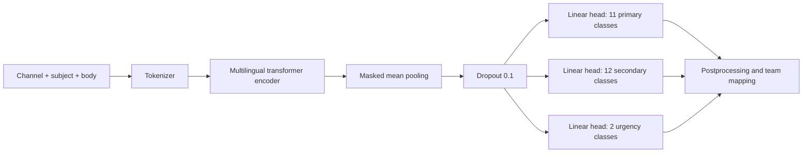
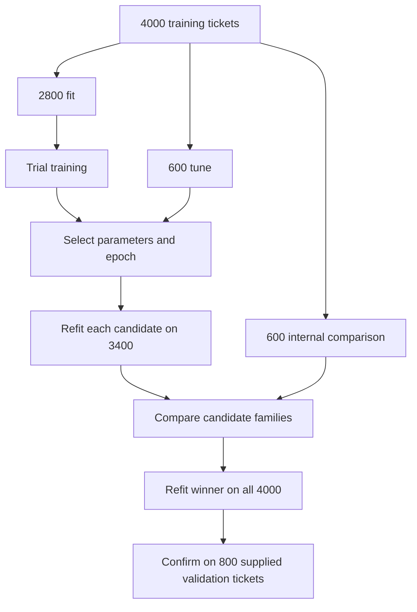
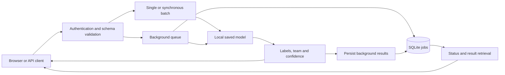
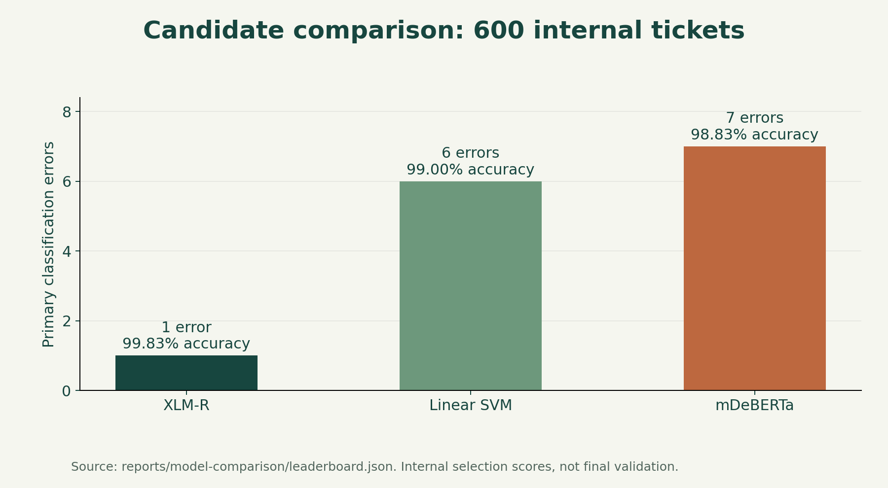
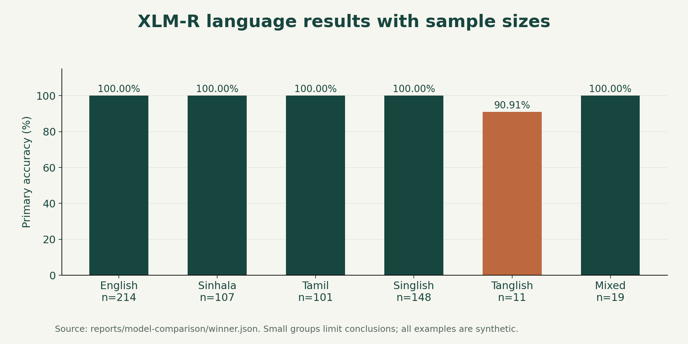
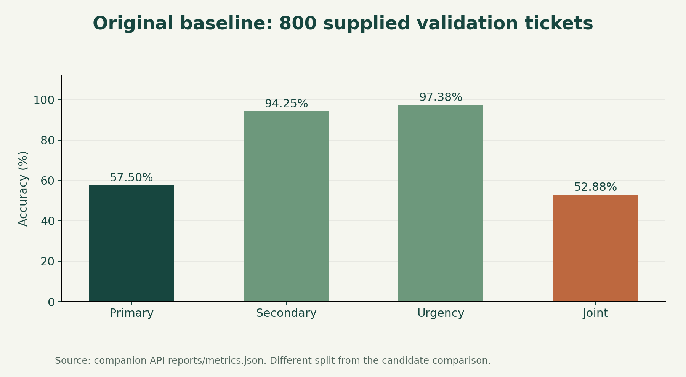

# Team Hydra — TensorForge 2.0

## 1. Project Title

**Team Hydra multilingual ticket classifier, TensorForge 2.0 MVP.** A fine-tuned XLM-R encoder predicts the primary issue, optional secondary issue and urgency, with a deterministic support-team mapping.

- Selected candidate: `FacebookAI/xlm-roberta-base` with three supervised heads.
- Experiment protocol: `tensorforge-tournament-v1`.
- Saved neural API version verified: `hydra-xlmr-f0899a3b764b3324`.
- Internal primary accuracy: **99.83% on 600 comparison tickets**.
- Final winner validation: **pending in the reviewed artifacts**.

The recorded comparison selects XLM-R. This is an internal selection result, not an official competition score. The original baseline scored 57.50% on a different, supplied validation set; these values are not a measured improvement on the same test set.

## 2. Overview

Team Hydra routes multilingual support tickets for the fictional RideEat platform. We created it to handle overlapping issues, informal spelling, Sinhala and Tamil Unicode, and Latin-script transliterations. Each prediction includes primary category, optional secondary category, urgency, mapped team and primary confidence.

Three experiments compare contextual encoders with a lower-cost sparse classifier. Training and inference use local code and saved artifacts. The solution does not call an external LLM for ticket classification. This repository includes the training scripts, FastAPI service, browser frontend, baseline model, evaluation evidence and Docker configuration. See [Team Hydra setup](TEAM_HYDRA.md) for operational details.

## 3. Features

- Eleven primary categories, twelve secondary outcomes including `none`, and binary urgency.
- English, Sinhala, Tamil, Singlish, Tanglish and mixed-language performance breakdowns.
- Standalone XLM-R, mDeBERTa and TF-IDF + linear SVM experiments.
- Shared splits, dataset fingerprints, saved predictions and reproducible ranking.
- Hyperparameter search, candidate refitting, final-winner training and offline inference.
- Primary confidence reporting, with sigmoid calibration for SVM.
- Companion API for single predictions, synchronous batches up to 100 and background jobs up to 5,000 tickets.
- Integrated frontend with batch upload, job progress, cancellation and result downloads.

## 4. Model Architecture

### Neural architecture



The word-embedding table stays frozen to reduce optimizer and gradient memory. Encoder layers and classification heads remain trainable. This fine-tunes pretrained encoders rather than training a language model from scratch.

| Property | XLM-R | mDeBERTa |
|---|---:|---:|
| Backbone | `FacebookAI/xlm-roberta-base` | `microsoft/mdeberta-v3-base` |
| Transformer layers | 12 | 12 |
| Hidden width | 768 | 768 |
| Attention heads per layer | 12 | 12 |
| Feed-forward width | 3,072 | 3,072 |
| Vocabulary size | 250,002 | 251,000 |
| Saved tensor elements, encoder + heads | 278,062,873 | 278,237,977 |
| Frozen word-embedding elements | 192,001,536 | 192,768,000 |
| Remaining parameter elements under this freeze rule | 86,061,337 | 85,469,977 |

Dimensions come from saved encoder configurations. Counts come from safetensors shapes and the script's embedding freeze rule; training prints exact runtime total/trainable counts. The three output heads together contain 19,225 parameters, including biases.

### Training parameters

| Setting | Search/default or selected value |
|---|---|
| Learning-rate search | `1e-5`, `2e-5`, `3e-5` |
| Selected neural learning rate / epochs | `3e-5` / 5 for both saved candidates |
| Token limit | 256; long inputs retain approximately 75% beginning and 25% end |
| Microbatch / accumulation | 2 / 8, effective batch size 16 |
| Optimizer | AdamW; weight decay 0.01 excluding bias/normalization |
| Schedule | 10% warm-up, then linear decay |
| Gradient clipping | Norm 1.0 |
| Early-stopping patience | 2 trial epochs |
| Precision | FP32 trainable parameters, CUDA FP16 autocast and gradient scaling |
| Memory control | Frozen word embeddings and gradient checkpointing |
| Loss | Primary cross-entropy + 0.5 secondary loss + 0.5 urgency loss |
| Class weights | Primary unweighted; bounded inverse-square-root-frequency weights for secondary/urgency |
| Random seed | 42 |

**Linear SVM:** word and character TF-IDF feed three classifiers. The primary search covers 18 combinations of feature mix, regularization (`C` in 0.25, 1, 4), and class weighting. Selected settings use balanced features, primary `C=1` unweighted, secondary `C=4` unweighted, and urgency `C=1` balanced. Primary confidence uses three-fold sigmoid calibration inside fitting data; those folds share the fitting-set vocabulary.

**Output rules:** a secondary label equal to the primary becomes `none`. Spam becomes nonurgent with no secondary. All candidates use the same rules. The team is a fixed mapping from primary category.

## 5. Technologies

| Technology | Purpose |
|---|---|
| Python | Training, evaluation and API implementation |
| PyTorch 2.10.0 | Neural training and inference |
| Transformers 5.0.0 | Pretrained encoders and tokenizers |
| Tokenizers 0.22.2, SentencePiece, safetensors | Tokenization and neural artifacts |
| NumPy 2.4.1, SciPy 1.17.0 | Numerical arrays and sparse operations |
| scikit-learn 1.8.0 | TF-IDF, SVM, calibration and metrics |
| Joblib 1.5.3, threadpoolctl | Classical persistence and thread control |
| FastAPI, Uvicorn, JSON Schema | Companion API and validation |
| SQLite, Docker | Persistent jobs and portable serving |
| HTML, CSS, JavaScript | Browser frontend |
| Matplotlib, optional | README chart generation |

TensorFlow is not used. Install the committed requirement files. Saved neural metadata records Python 3.14.6 and PyTorch 2.10.0+cu128.

## 6. Project Structure

```text
tensorforge/
├── README.md
├── TEAM_HYDRA.md                  # Authentication and model-serving guide
├── DOCKER_OTHER_PC_GUIDE.md       # Transfer the Docker image to another PC
├── Start-Hydra.ps1                # Private API-key prompt and server launch
├── Dockerfile
├── compose.yaml                  # Single service with persistent jobs volume
├── requirements.txt              # Baseline/API dependencies
├── requirements-neural.txt       # Optional neural dependencies; torch separate
├── train.py                      # Baseline training and validation
├── app/                          # API, authentication, model loaders, jobs
├── web/                          # Frontend HTML, CSS, JavaScript and favicon
├── specs/                        # Supplied OpenAPI 2.1.0 and JSON Schemas
├── models/baseline.joblib         # Bundled default model
├── data/                         # Supplied train/validation JSONL and notes
├── tests/                        # API, authentication, lifecycle and neural checks
├── reports/
│   ├── metrics.json              # Baseline validation evidence
│   ├── evaluation.md
│   ├── hydra-verification.md
│   └── model-comparison/         # Copied candidate results and internal winner
├── docs/
│   ├── generate_charts.py
│   └── images/                   # README PNG charts
├── model-tournament/
│   ├── computer_1_xlmr.py
│   ├── computer_2_mdeberta.py
│   ├── computer_3_linear_svm.py
│   ├── requirements-cpu.txt
│   ├── requirements-gpu.txt
│   ├── data/
│   └── results_svm/              # Existing classical candidate
└── runtime/                      # Generated local job state; excluded from Git
```

**Package status:** this final folder includes the default baseline and SVM candidate, but not the large XLM-R/mDeBERTa weights. The saved neural results are evidence from separate completed experiments. To serve XLM-R, transfer its complete saved model directory or train it using the commands below. A neural model requires `encoder/`, `heads.safetensors` and `metadata.json`; copying only the heads is insufficient.

All README image and evidence links stay inside this repository. The diagrams use Mermaid, supported by GitHub's Markdown renderer. Local previews without Mermaid support may display their source code instead.

## 7. Installation

Run these PowerShell commands from the **tensorforge repository root**, the directory containing `Dockerfile`. Python 3.14 is the recorded project environment.

### Start with the bundled baseline

```powershell
py -3.14 -m venv .venv
.\.venv\Scripts\python -m pip install --upgrade pip
.\.venv\Scripts\python -m pip install -r requirements.txt
.\Start-Hydra.ps1
```

Enter the exact assigned key at the hidden prompt. Open **http://localhost:8000/** for the frontend or **http://localhost:8000/docs** for interactive API documentation. Enter the same key in the frontend. The browser clears it on refresh. The launcher never writes the key into the repository.

If PowerShell blocks the launcher, invoke it with `powershell -ExecutionPolicy Bypass -File .\Start-Hydra.ps1`. Keep the server terminal open; Ctrl+C stops it.

### Optional neural CPU inference

```powershell
.\.venv\Scripts\python -m pip install torch==2.10.0 --index-url https://download.pytorch.org/whl/cpu
.\.venv\Scripts\python -m pip install -r requirements-neural.txt
```

### Optional GPU training

Each intended training PC has Ryzen 7, 16 GB RAM and RTX 4050 6 GB. Install a compatible NVIDIA driver. Computers run independent experiments, not pooled GPU training.

```powershell
.\.venv\Scripts\python -m pip install --force-reinstall torch==2.10.0 --index-url https://download.pytorch.org/whl/cu128
.\.venv\Scripts\python -m pip install -r model-tournament/requirements-gpu.txt
.\.venv\Scripts\python model-tournament/computer_1_xlmr.py check
```

`CUDA available` must be `True` before a full GPU run. Substitute the mDeBERTa script on computer 2. SVM requires only `model-tournament/requirements-cpu.txt`. These wheel commands follow [PyTorch's version-specific instructions](https://pytorch.org/get-started/previous-versions/#v2-10-0). Initial model downloads need internet access and substantial free disk space. Saved model inference is offline.

### Docker baseline setup

Start Docker Desktop and confirm `docker version` shows both Client and Server. In the same PowerShell window:

```powershell
$secret = Read-Host 'Enter assigned API key' -AsSecureString
$env:API_KEY = [System.Net.NetworkCredential]::new('', $secret).Password
docker compose up -d --build
Remove-Item Env:API_KEY
$secret.Dispose()
```

Open **http://localhost:8000/**. Compose keeps job state in a named volume. The container retains its configured environment across restarts. Recreate it to change its key; do not share `docker inspect` or resolved Compose configuration output. No assigned key is embedded in this README.

See [Docker transfer instructions](DOCKER_OTHER_PC_GUIDE.md) and [neural Docker packaging](TEAM_HYDRA.md#container-and-persistent-jobs). The default Docker build bundles the baseline. Neural deployment needs both neural dependencies and the complete selected artifact.

## 8. Dataset

Source: the supplied **TensorForge 2.0 MVP Resources Dataset**, described in [DATA_NOTES.md](data/DATA_NOTES.md) as RideEat multilingual workshop dataset revision 2. All records are synthetic.

| Supplied split | Tickets | Use |
|---|---:|---|
| Training | 4,000 | Fitting and internal selection |
| Validation | 800 | Final confirmation; already evaluated for the original baseline |

Language shares: English 35%, Singlish 25%, Sinhala 20%, Tamil 15%, Tanglish 2.5%, mixed 2.5%.

Preprocessing reads UTF-8 JSONL, validates IDs/labels/Boolean urgency, rejects duplicate IDs and exact duplicate model inputs, and concatenates channel, subject and body. Unicode combining marks are preserved. Ticket IDs and language tags are excluded from features. Neural models use their backbone tokenizer; classical models learn vocabulary only from fitting data.

Native speakers have not independently reviewed the synthetic non-English text. Exact duplicate checks do not eliminate related templates or semantic overlap.



## 9. Training

All commands below run from this repository root and use its `.venv`.

### Reproduce the baseline

```powershell
.\.venv\Scripts\python train.py
```

This trains on `data/train.jsonl`, evaluates `data/validation.jsonl`, and replaces `models/baseline.joblib` and baseline report files. Preserve the recorded artifact/reports before rerunning if you need the published results. Retraining can change the artifact-derived API version.

### Run one candidate per computer

Install the appropriate training requirements from section 7. Keep the supplied training data unchanged. Use fresh result directories:

```powershell
# Computer 1
.\.venv\Scripts\python model-tournament/computer_1_xlmr.py train --out model-tournament/results_xlmr_run2

# Computer 2
.\.venv\Scripts\python model-tournament/computer_2_mdeberta.py train --out model-tournament/results_mdeberta_run2

# Computer 3
.\.venv\Scripts\python model-tournament/computer_3_linear_svm.py train --out model-tournament/results_svm_run2
```

Neural scripts try three learning rates and up to five epochs, then refit the selected configuration. Estimate runtime using logged epoch times. For GPU memory pressure, close other GPU applications and retry in a fresh directory with `--batch-size 1 --accumulation 16`. Reducing `--max-length` to 192 saves memory but loses context. Interrupted training restarts from scratch.

### Compare and finalize on one computer

Transfer all three complete new result folders into this repository's `model-tournament/` directory, then run:

```powershell
.\.venv\Scripts\python model-tournament/computer_1_xlmr.py compare --runs model-tournament/results_xlmr_run2 model-tournament/results_mdeberta_run2 model-tournament/results_svm_run2 --out model-tournament/comparison_run2
.\.venv\Scripts\python model-tournament/computer_1_xlmr.py finalize --winner model-tournament/comparison_run2/winner.json --out model-tournament/best_model_run2
```

Comparison verifies dataset/split fingerprints and saved ticket IDs, then ranks primary accuracy, primary macro F1 and joint accuracy in that order. This is the project's selection rule, not a claim about the organizer's aggregate formula. Finalize supports whichever family wins, refits on 4,000 rows, evaluates the supplied 800 validation rows, and saves predictions, reports and checksums.

The files in `reports/model-comparison/` preserve the earlier experiments, with machine-specific original run paths. Use newly generated run outputs for the commands above. A finalized XLM-R result was absent from the reviewed evidence. Once validation informs additional tuning, reserve a new independent test set.

## 10. Usage

### Classify in the browser

Start the server using section 7, open `http://localhost:8000/`, enter your key and choose **Use key**. Add a customer message and select **Classify ticket**. **Batch tickets** accepts JSON/JSONL uploads. Up to 100 tickets run synchronously; larger batches create a background job.

Example ticket input:

```json
{"ticket_id":"DEMO-001","channel":"chat","text":"I was charged twice for the same ride. Please refund the duplicate payment."}
```

The response contains `category`, `secondary_category`, `is_urgent`, `team`, `confidence` and the input ID when present. Check the model version shown in the UI or `/health` to identify the loaded model.

### API contract

| Method | Endpoint | Behavior |
|---|---|---|
| GET | `/health` | Public readiness and model version |
| POST | `/predict` | Single ticket |
| POST | `/predict/batch` | 1–100 tickets, unique IDs, ordered predictions |
| POST | `/batch/jobs` | 1–5,000 tickets, asynchronous job |
| GET | `/batch/jobs/{job_id}` | Status and progress |
| GET | `/batch/jobs/{job_id}/results` | Ordered, paginated predictions |
| DELETE | `/batch/jobs/{job_id}` | Cancel active or discard finished jobs |

Protected operations accept `X-API-Key` or `Authorization: Bearer`. Authentication precedes content-type, size, parsing and schema checks. Single, synchronous-batch and job bodies have 1/5/25 MiB limits respectively. The supplied contract lives in [specs](specs/tensorforge-phase2-openapi-v2.yaml).

With `API_KEY` already set privately in your shell, a Bash example is:

```bash
curl http://localhost:8000/health
curl -X POST http://localhost:8000/predict \
  -H "X-API-Key: $API_KEY" -H "Content-Type: application/json" \
  -d '{"ticket_id":"DEMO-001","channel":"chat","text":"I was charged twice for my ride."}'
```

### Serve a neural artifact

Transfer the complete selected neural model to `models/deployed/` and install neural dependencies from section 7. Then run:

```powershell
.\Start-Hydra.ps1 -ModelPath .\models\deployed
```

That folder must contain `metadata.json`, `heads.safetensors` and the full `encoder/` directory. These large weights are not included in the current final folder. The loader also supports SVM directories. Do not load untrusted joblib artifacts. Use `MODEL_PATH` for deployment configuration and `JOB_DB_PATH` to select persistent SQLite storage.

### Offline JSONL prediction

After running the training/finalization workflow, create `tickets.jsonl` using one input object per line:

```powershell
.\.venv\Scripts\python model-tournament/computer_1_xlmr.py predict --model model-tournament/best_model_run2/model --input tickets.jsonl --out predictions.jsonl
```



**One Uvicorn process and one replica are supported.** The database process lock rejects a second worker using the same database. Capacity is one running job plus three queued jobs. Completed results persist for at least six hours. Unknown IDs return 404 and expired IDs return 410. Idempotency keys reuse the original job; use a new key after expiry. On process restart, interrupted queued/running jobs become failed with `interrupted`. A persistent volume keeps this state across container replacements. Multi-replica deployment needs a shared queue/database redesign.

## 11. Performance

### Internal comparison: 600 tickets

Source: [leaderboard.json](reports/model-comparison/leaderboard.json), [winner.json](reports/model-comparison/winner.json) and the candidate result files in `reports/model-comparison/`. Each candidate fits 3,400 rows before comparison.

| Candidate | Primary accuracy | Primary macro F1 | Primary log loss | Secondary accuracy | Urgency accuracy | Joint accuracy |
|---|---:|---:|---:|---:|---:|---:|
| **XLM-R** | **99.83%** | **0.9975** | **0.00713** | 99.83% | 99.83% | 99.83% |
| Linear SVM | 99.00% | 0.9892 | 0.04922 | 99.83% | 99.83% | 99.00% |
| mDeBERTa | 98.83% | 0.9860 | 0.07574 | 99.00% | 99.33% | 97.50% |



XLM-R makes one primary error, SVM six and mDeBERTa seven. XLM-R's advantage over SVM is five tickets, or 0.83 percentage points. A single split and seed do not establish statistical superiority. Log loss describes probability quality on this comparison set; it is not training loss or final validation performance.

### Language and safety findings



Tanglish has 10 correct primary predictions out of 11. Other language groups have no primary errors in this internal sample. Group sizes appear on the chart; the 19-ticket mixed and 11-ticket Tanglish groups support limited conclusions.

- Urgent recall: **59/60 = 98.33%**, with no false-positive urgency predictions.
- Primary safety recall: **23/24 = 95.83%**. One safety ticket becomes a trip issue.
- The joint result shows the same ticket accounts for all three target errors.
- Secondary labels are absent in **549/600** rows. Always predicting `none` would score 91.5%.
- Secondary macro F1 is **0.4978**, averaged over 12 fixed labels including six with zero support and zero F1. Urgency macro F1 is **0.9953**.

### Original baseline: different validation set

The logistic-regression baseline trained on 4,000 tickets and evaluated on the supplied 800 validation tickets. Source: [baseline evaluation](reports/evaluation.md).

| Target | Accuracy | Macro F1 |
|---|---:|---:|
| Primary | 57.50% | 0.6045 |
| Secondary | 94.25% | 0.5412 |
| Urgency | 97.375% | 0.9194 |
| Joint exact match | 52.875% | — |



Primary log loss is 1.5096. Baseline urgency recall is 61/80 (76.25%). Baseline secondary macro F1 uses labels present in truth/predictions, whereas the tournament uses fixed labels. **These baseline and candidate scores use different splits and must not be presented as a direct validation improvement.** Final XLM-R validation is not recorded in the reviewed artifacts.

### Serving checks

The [API verification report](reports/hydra-verification.md) records baseline real-HTTP single-request p95 of **9.91 ms** (30 requests), 100-ticket batch p95 of **31.49 ms** (10 requests), and startup of **5.77 s** on the development host. These are small synthetic workloads, not XLM-R or reference-hardware benchmarks.

Saved XLM-R CPU inference matched eight predictions from the tournament loader, and a separate neural API integration test passed. A concurrent HTTP authentication check returned 96 expected successes and 32 expected unauthorized responses. These are software checks, not a new model evaluation.

Regenerate the charts from saved results:

```powershell
.\.venv\Scripts\python -m pip install matplotlib
.\.venv\Scripts\python docs/generate_charts.py
```

## 12. Limitations

- Synthetic data and possible template overlap can inflate internal scores.
- Non-English examples lack independent native-speaker review, and small groups have uncertain estimates.
- Final XLM-R validation, multi-seed studies, real-customer evaluation and controlled ablations are not recorded here.
- Neural softmax confidence is not separately calibrated and can be confidently wrong.
- The missed urgent safety case needs investigation before autonomous triage.
- Token truncation can remove relevant context. Neural training cannot resume mid-epoch.
- Neural latency and memory on the competition's 2-vCPU/4-GB target remain unverified.
- The API supports one process/replica, without distributed jobs or automatic high availability.
- This model classifies text; it does not generate support replies, process raw audio or replace human safety decisions.
- Docker execution and uninterrupted public hosting need deployment verification beyond the local recorded checks.

## 13. Roadmap

- [ ] Finalize on all training rows and record supplied-validation metrics.
- [ ] Add reviewed multilingual cases, rare secondary issues and targeted safety examples.
- [ ] Compare template-grouped splits and multiple seeds.
- [ ] Measure calibration and review coverage before choosing confidence thresholds.
- [ ] Benchmark neural memory and latency on deployment hardware.
- [ ] Verify Docker transfer, persistent-job recovery and public HTTPS availability.
- [ ] Add resumable training and distributed jobs if needed.

## 14. Contributing

1. Describe the proposed change or reproducible issue before major implementation changes.
2. Work on a separate branch. Keep secrets, environments, datasets and large weights out of commits.
3. Preserve the split protocol for comparable experiments. Record configuration, dependency versions, hashes and subgroup metrics.
4. Use new output directories rather than overwriting saved evidence.
5. Run relevant checks and submit a pull request explaining behavior, verification and limitations.

For training scripts, `check` reports CUDA availability. SVM `--smoke` is a software sanity check and cannot enter the tournament. For API changes, run `.\.venv\Scripts\python -m unittest discover -s tests -v` from this repository root. Its optional neural test needs `NEURAL_TEST_MODEL` pointing to a saved model. Only load trusted artifacts, particularly pickle/joblib models. Do not tune against final validation labels and describe the resulting score as untouched.

## 15. License

**A project license has not been specified.** This README does not choose or grant an open-source license on the team's behalf. Team Hydra should add its intended `LICENSE` before distributing the code for reuse.

Dataset and pretrained model terms are separate. Consult supplied dataset/competition terms and the upstream [XLM-R model card](https://huggingface.co/FacebookAI/xlm-roberta-base) and [mDeBERTa model card](https://huggingface.co/microsoft/mdeberta-v3-base) before redistribution. No dataset redistribution permission is asserted here.

## 16. Author

**Team Hydra** — TensorForge 2.0 MVP project.

Individual names and public contact information have not been supplied. Use repository issues for project discussion once the repository is shared. Add team-approved contributor names and a public contact channel before submission. Do not publish private credentials or personal contact details without consent.
